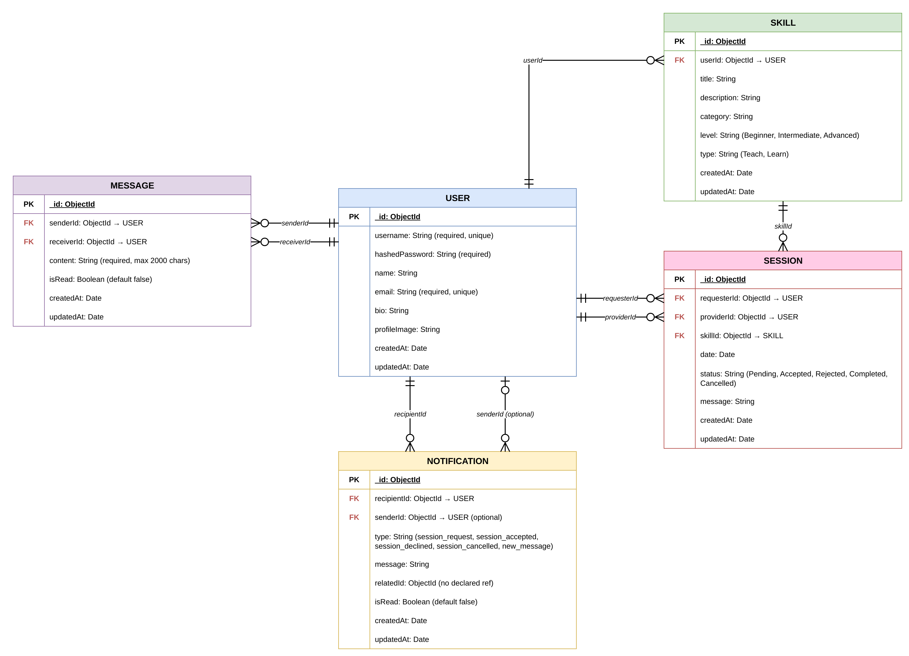

# SkillSwap Backend API

## Overview

This repository contains the Node.js, Express.js, and MongoDB backend for **SkillSwap**, a student-to-student skill exchange platform.

SkillSwap allows students to share skills they can teach, discover skills they want to learn, and connect with other students through learning sessions.

The backend provides RESTful API endpoints for user authentication, skill management, messaging, session management, availability scheduling, and notifications.

Students can create **Teach** and **Learn** skill listings, connect with other students, send session requests, and manage their learning sessions.

## Related Links

- **Backend API:** https://project-3-backend-y717.onrender.com
- **Frontend Application:** https://skillswap100.netlify.app/
- **Frontend Repository:** https://github.com/raf266/SkillSwap-Frontend

## Technologies Used

- Node.js
- Express.js
- MongoDB
- Mongoose
- JavaScript
- JSON Web Tokens (JWT)
- Authentication middleware
- Rate-limiting middleware


## Features

- User registration and login
- JWT authentication and protected routes
- User profile management
- Create, view, update, and delete skills
- Teach and Learn skill listings
- Search and filter skills
- Skill availability management
- Request sessions for Teach and Learn skills
- View incoming and outgoing sessions
- Accept or reject session requests
- Cancel eligible sessions
- Mark accepted sessions as completed
- Student messaging
- Session notifications
- MongoDB relationships using Mongoose
- ObjectId validation middleware
- Ownership-based authorization
- Rate-limiting middleware
- Error handling with appropriate HTTP status codes

## Project Structure

```text
backend/
├── config/
├── middleware/
│   ├── rateLimiters.js
│   ├── validateObjectId.js
│   └── verifyToken.js
├── models/
│   ├── Message.js
│   ├── Notification.js
│   ├── Session.js
│   ├── Skill.js
│   └── User.js
├── routes/
│   ├── auth.routes.js
│   ├── message.routes.js
│   ├── notification.routes.js
│   ├── session.routes.js
│   ├── skill.routes.js
│   └── user-routes.js
├── .env
├── .gitignore
├── package-lock.json
├── package.json
├── README.MD
└── server.js
```

### Folder Responsibilities

| Folder / File | Purpose |
|---|---|
| `config/` | Database and application configuration |
| `middleware/` | Authentication, ObjectId validation, and rate limiting |
| `models/` | Mongoose schemas and database models |
| `routes/` | Express API route definitions |
| `server.js` | Server configuration, route mounting, and startup |
| `package.json` | Project dependencies and scripts |
| `.env` | Environment variables and sensitive configuration |
| `.gitignore` | Files and folders excluded from Git |
| `README.MD` | Project documentation |

## Getting Started

### Prerequisites

Install the following before running the project:

- Node.js
- npm
- MongoDB locally or a MongoDB Atlas account
- Git

## Installation

### 1. Clone the repository

```bash
git clone https://github.com/raf266/SkillSwap-Backend.git
cd SkillSwap-Backend
```

### 2. Install dependencies

```bash
npm install
```

### 3. Create the environment file

Create a `.env` file in the root directory:

```env
PORT=3000
MONGODB_URI=your-mongodb-connection-string
CLIENT_URL=http://localhost:5173
JWT_SECRET=your-secure-jwt-secret
```

Do not commit `.env` to GitHub.

### 4. Start the development server

```bash
npm run dev
```

Make sure the `dev` script exists in `package.json`.

The backend API should be available at:

```text
http://localhost:3000
```

## Database Models

### User

The User model stores registered student account information.

| Field | Type | Description |
|---|---|---|
| `_id` | ObjectId | MongoDB-generated identifier |
| `name` | String | Student's display name |
| `email` | String | Student's email address |
| `password` | String | Authentication credential |

Additional fields and validation rules should be confirmed against `models/User.js`.

### Skill

The Skill model stores the skills students want to teach or learn.

| Field | Type | Description |
|---|---|---|
| `userId` | ObjectId | Reference to the skill owner |
| `title` | String | Name of the skill |
| `description` | String | Skill description |
| `category` | String | Skill category |
| `level` | String | Skill difficulty |
| `type` | String | Teach or Learn |
| `availability` | Array | Available teaching slots |

Each availability slot contains:

| Field | Type | Description |
|---|---|---|
| `date` | Date | Available date |
| `startTime` | String | Start time |
| `endTime` | String | End time |

### Session

The Session model stores student session requests.

| Field | Type | Description |
|---|---|---|
| `requesterId` | ObjectId | User requesting the session |
| `providerId` | ObjectId | Owner of the skill listing |
| `skillId` | ObjectId | Related skill |
| `date` | Date | Requested session date |
| `status` | String | Current session status |
| `message` | String | Optional request message |
| `createdAt` | Date | Automatically generated |
| `updatedAt` | Date | Automatically generated |

Possible session statuses are:

- Pending
- Accepted
- Rejected
- Cancelled
- Completed

### Message

The Message model stores communication between students.

| Field | Description |
|---|---|
| Sender reference | User sending the message |
| Recipient reference | User receiving the message |
| Message content | Text sent between users |


### Notification

The Notification model stores updates about session activity.

| Field | Description |
|---|---|
| `recipientId` | User receiving the notification |
| `senderId` | User triggering the notification |
| `type` | Notification type |
| `message` | Notification text |
| `relatedId` | Related session identifier |

The session routes generate notifications for new requests, accepted requests, declined requests, and cancelled sessions.

## Entity Relationships

SkillSwap uses MongoDB ObjectId references to connect related data.

- One user can create multiple skills.
- One user can request multiple sessions.
- One skill can have multiple session requests.
- A session references the requester, skill owner, and related skill.
- Messaging connects students.
- Notifications connect users to important session events.

### Entity Relationship Diagram (ERD)




## Endpoints

### Authentication

| Method | Endpoint | Access | Description |
|---|---|---|---|
| POST | [Confirm registration endpoint] | Public | Register a new user |
| POST | [Confirm login endpoint] | Public | Log in and receive an authentication token |

Confirm the endpoint paths using `routes/auth.routes.js`.

### Users

| Method | Endpoint | Access | Description |
|---|---|---|---|
| GET | [Confirm user endpoint] | Authenticated | Retrieve user information |
| PATCH/PUT | [Confirm update endpoint] | Authenticated | Update user information |

Confirm the endpoint paths using `routes/user-routes.js`.

### Skills

| Method | Endpoint | Access | Description |
|---|---|---|---|
| GET | `/api/skills` | Check route configuration | Retrieve available skills |
| GET | `/api/skills/:id` | Check route configuration | Retrieve skill details |
| POST | [Confirm create endpoint] | Authenticated | Create a skill |
| PATCH/PUT | [Confirm update endpoint] | Skill owner | Update a skill |
| DELETE | [Confirm delete endpoint] | Skill owner | Delete a skill |
| PUT | `/api/skills/:id/availability` | Skill owner | Update teaching availability |

### Sessions

All session endpoints require authentication.

| Method | Endpoint | Access | Description |
|---|---|---|---|
| POST | `/api/sessions` | Authenticated | Request a session |
| GET | `/api/sessions/my` | Authenticated | Retrieve the current user's sessions |
| PATCH | `/api/sessions/:id/accept` | Skill owner | Accept a pending request |
| PATCH | `/api/sessions/:id/reject` | Skill owner | Reject a pending request |
| PATCH | `/api/sessions/:id/cancel` | Authorized participant | Cancel an eligible session |
| PATCH | `/api/sessions/:id/complete` | Skill owner | Complete an accepted session |

### Messages

| Method | Endpoint | Access | Description |
|---|---|---|---|
| [Confirm] | [Confirm message endpoint] | Authenticated | Send or retrieve messages |

Confirm the message endpoints using `routes/message.routes.js`.

### Notifications

| Method | Endpoint | Access | Description |
|---|---|---|---|
| [Confirm] | [Confirm notification endpoint] | Authenticated | Retrieve or manage notifications |

Confirm the endpoints using `routes/notification.routes.js`.

## Status Codes

| Status | Meaning in This API |
|---|---|
| `200` | Request completed successfully |
| `201` | Resource created successfully |
| `400` | Invalid request or data |
| `401` | Authentication required or invalid |
| `403` | User does not have permission |
| `404` | Requested resource not found |
| `500` | Unexpected server error |


## Testing

### Manual API Testing

The API can be tested using Postman or another API testing tool.

Suggested tests include:

1. Register a new user.
2. Log in and obtain a JWT.
3. Create a Teach or Learn skill.
4. Retrieve and filter available skills.
5. Add availability to a Teach skill.
6. Request a session for another student's skill.
7. Attempt to request your own skill.
8. Accept or reject a pending session.
9. Cancel an eligible session.
10. Complete an accepted session.
11. Send and retrieve messages.
12. Verify session notifications.

## Future Enhancements

- Prevent duplicate session bookings
- Validate teaching availability on the server
- Add reminders for upcoming sessions
- Improve Teach and Learn session role handling
- Add automated API testing
- Improve error handling and validation
- Expand messaging and notification functionality

## Team Members

| Name | Responsibilities |
|---|---|---|
| [Sara]  | Authentication and user management |
| [Waad]  | Skill management |
| [Raghad] | Session management, availability calendar |

## Credits

- [Node.js](https://nodejs.org/)
- [Express.js](https://expressjs.com/)
- [MongoDB](https://www.mongodb.com/)
- [Mongoose](https://mongoosejs.com/)
- [JWT](https://jwt.io/)

SkillSwap was developed as a collaborative student project.

**Backend Repository:** https://github.com/raf266/SkillSwap-Backend

**Frontend Repository:** https://github.com/raf266/SkillSwap-Frontend
